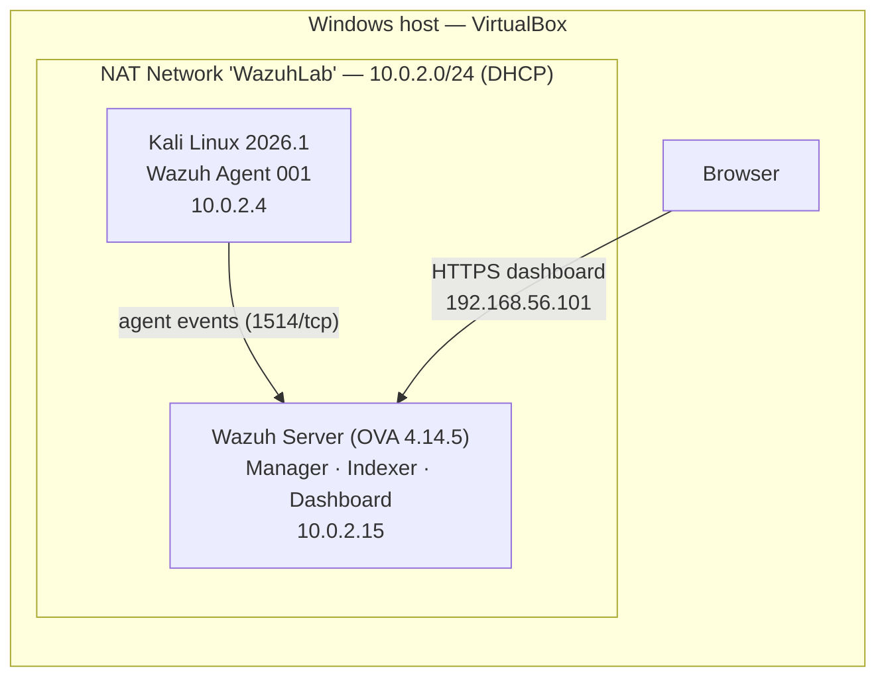

# 🔬 Wazuh SIEM Home Lab

A small virtual lab built to learn how a SIEM collects, parses and classifies Linux logs. A self-hosted **Wazuh** server monitors a **Kali Linux** endpoint; two simple attack simulations are then run on the endpoint and the resulting alerts are analysed and mapped to **MITRE ATT&CK**.

> Full step-by-step documentation with screenshots (in Italian): [`Documentazione SIEM.pdf`](./Documentazione%20SIEM.pdf)

---

## 🏗️ Lab Architecture



| Component | Details |
|---|---|
| Hypervisor | Oracle VirtualBox |
| SIEM server | Official Wazuh OVA **v4.14.5** (manager, indexer and dashboard preconfigured) — 8 GB RAM, 4 vCPU |
| Monitored endpoint | Kali Linux **2026.1** amd64 — 2 GB RAM, 25 GB disk — `wazuh-agent 4.14.5-1` |
| Network | VirtualBox NAT Network `WazuhLab` (`10.0.2.0/24`, DHCP). The dashboard is reached from the host through a second adapter (`192.168.56.101`) |

---

## ⚙️ Setup Summary

**Server**
1. Created the NAT Network `WazuhLab` in VirtualBox.
2. Imported the official Wazuh `.ova` and logged in to the VM.
3. Started the services:
   ```bash
   sudo systemctl start wazuh-manager wazuh-indexer wazuh-dashboard
   ```
4. Retrieved the IP with `ip a` and opened the dashboard from the host browser.

**Agent**
1. Created the Kali VM and attached it to the same NAT Network.
2. Generated the install command from *Dashboard → Deploy new agent* (Linux, DEB amd64, server `10.0.2.15`, name `WazuhAgent`).
3. Installed the package with the generated `wget` command, then enabled the service:
   ```bash
   sudo systemctl daemon-reload
   sudo systemctl enable wazuh-agent
   sudo systemctl start wazuh-agent
   ```
4. Verified the agent in *Endpoints*: `WazuhAgent` — ID `001`, IP `10.0.2.4`, status **Active**.

---

## ⚔️ Attack Simulations & Detections

### 1. Failed SSH logins — Brute Force (`T1110`)

**What was done:** several SSH logins with a non-existent user and wrong passwords were attempted in quick succession on the Kali machine itself:

```bash
ssh utente_inventato@localhost
```

`sshd` rejected every attempt (`Permission denied`) and the failures were recorded through PAM in the systemd journal, which the agent forwards to the manager.

**Alert in Wazuh (Discover):**

| Field | Value |
|---|---|
| `agent.name` / `agent.id` / `agent.ip` | `WazuhAgent` / `001` / `10.0.2.4` |
| `location` | `journald` |
| `decoder.name` | `sshd` |
| `rule.id` / `rule.level` | `2502` / `10` |
| `rule.description` | *syslog: User missed the password more than one time* |
| `rule.mitre` | `T1110` — Brute Force (Credential Access) |

### 2. Local account creation — Persistence (`T1136`)

**What was done:** a local account was created to simulate an attacker keeping access to the machine:

```bash
sudo useradd hacker
```

> The screenshot in the PDF shows `useradd: user 'hacker' already exists` because the command was run a second time; the account had already been created by the first execution.

**Alert in Wazuh (Discover):**

| Field | Value |
|---|---|
| `agent.name` / `agent.id` / `agent.ip` | `WazuhAgent` / `001` / `10.0.2.4` |
| `decoder.name` | `sudo` |
| `full_log` | `kali : TTY=pts/0 ; PWD=/home/kali ; USER=root ; COMMAND=/usr/sbin/useradd hacker` |
| `data.command` / `data.dstuser` | `/usr/sbin/useradd hacker` / `root` |
| `rule.id` / `rule.level` | `5902` / `8` |
| `rule.description` | *New user added to the system* |
| `rule.mitre` | `T1136` — Create Account (Persistence) |

### Results

| Simulation | MITRE technique | Rule ID | Level | Detected |
|---|---|---|---|---|
| Failed SSH logins | T1110 — Brute Force | 2502 | 10 | ✅ |
| Local account creation | T1136 — Create Account | 5902 | 8 | ✅ |

Both events were detected, classified and mapped to MITRE ATT&CK by Wazuh's default ruleset, with no custom configuration.

---

## 📌 Takeaways

* **Out-of-the-box coverage:** with the default ruleset, Wazuh already detects common authentication failures and account changes on a Linux host.
* **Know where the logs live:** on modern Kali the events come from `journald`, not `/var/log/auth.log`. Knowing the log source is essential to understand which decoder and rule fire.
* **Structured fields make triage fast:** once decoded, fields like `agent.ip`, `data.command` and `rule.mitre` let an analyst filter and correlate events immediately.

---

## ⚠️ Limitations

* The SSH "attack" was manual and run from the endpoint against itself (`localhost`), not from a separate attacker machine.
* Only one monitored endpoint and two scenarios.
* Only default Wazuh rules were used; no custom decoders or rules were written.
* The OVA ships with default credentials, which must be changed in any non-lab environment.

---
*Developed as my High School Capstone project ("Capolavoro").*
